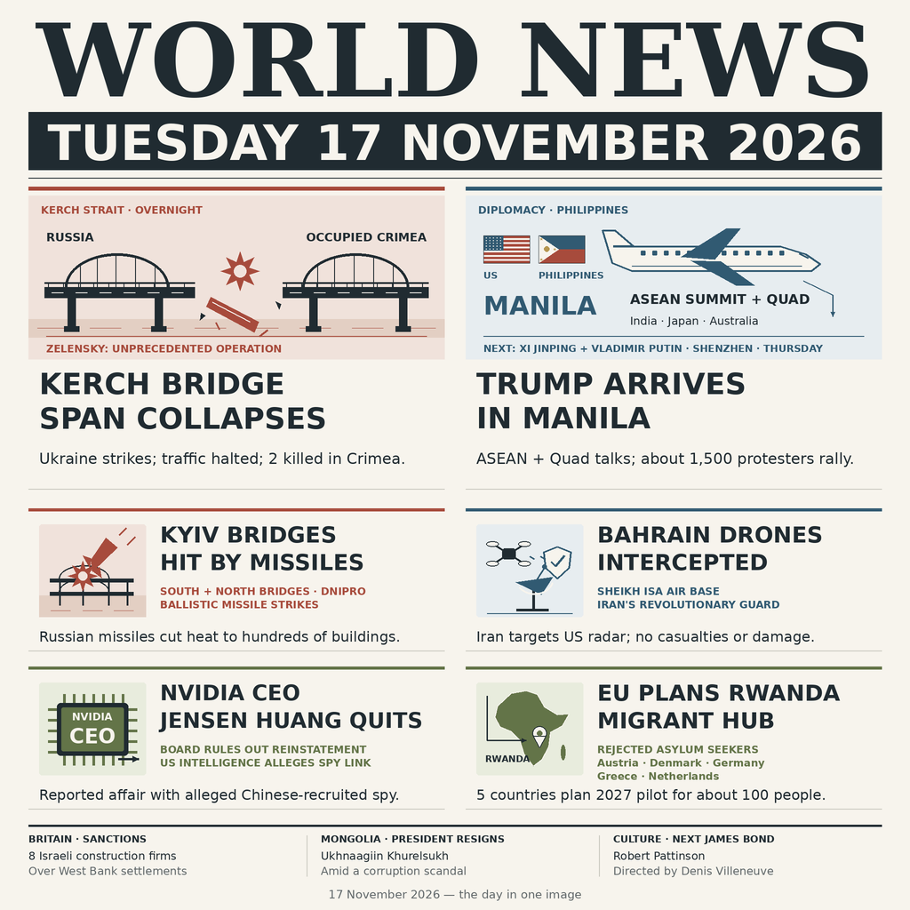

# World News — Tuesday 17 November 2026

[](https://make.fun/bounty/news-image-20261117)
[](https://make.fun/bounty/news-image-20261117)
[](https://make.fun/bounty/news-image-20261117)

An illustrated newspaper front page summarizes the supplied world news for Tuesday 17 November 2026, with a prominent date, two lead stories, four equal smaller stories, and three footer briefs. All illustrations and text are drawn offline with Pillow at 2048×2048 and downscaled into the finished 1024×1024 PNG. The Node entrypoint copies the bundled image into the output directory, using only the standard library and producing identical bytes on every run without network access.

The six main stories:

- **Kerch Bridge:** Ukraine struck the bridge linking Russia to occupied Crimea overnight; a road span collapsed into the water, vehicle traffic halted, and 2 people were killed in Crimea. President Zelensky called it an unprecedented operation.
- **Kyiv bridges:** Russia struck the South and North bridges over the Dnipro with ballistic missiles, cutting heating to hundreds of buildings.
- **Bahrain drones:** Iran's Revolutionary Guard targeted a US military radar at Sheikh Isa Air Base. Bahrain and US Central Command said the drones were intercepted, with no casualties or damage.
- **Trump in Manila:** US President Donald Trump arrived for the ASEAN summit and Quad talks with India, Japan and Australia, ahead of Thursday's meeting with Xi Jinping and Vladimir Putin in Shenzhen. About 1,500 protesters rallied against the visit.
- **Nvidia CEO resigns:** Founder and CEO Jensen Huang resigned amid reports of an affair with a woman US intelligence says was a Chinese-recruited spy. He said he would return if asked, but the board said it will not reinstate him.
- **EU–Rwanda hub:** Austria, Denmark, Germany, Greece and the Netherlands plan a return hub for rejected asylum seekers in Rwanda, with a pilot for about 100 people in 2027.

The footer covers Britain's sanctions on 8 Israeli construction firms over West Bank settlements, Mongolian President Ukhnaagiin Khurelsukh's resignation amid a corruption scandal, and Robert Pattinson being named the next James Bond, directed by Denis Villeneuve.

Run with Node 22:

```sh
node main.ts
```

The destination is `MAKEFUN_OUTPUT_DIR/entry.png`, defaulting to `/output/entry.png`. No install, build, or download step is needed.

To regenerate the bundled artwork locally, use Python 3 with Pillow and the system DejaVu fonts:

```sh
python3 render.py
```



Licensed under MIT; see [LICENSE](LICENSE).
